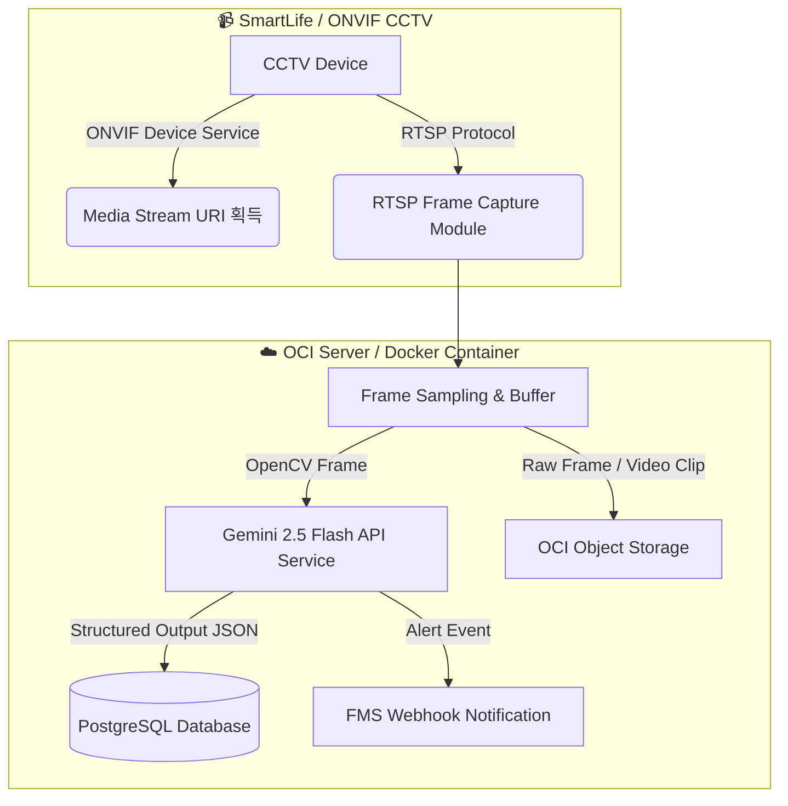

# 📹 ONVIF/RTSP CCTV 영상 수집 & OCI Gemini 2.5 AI 파이프라인 5단계 구축 계획

본 문서 프로젝트(`hoodyfarmkr-cctv`)에서 SmartLife/ONVIF CCTV의 영상 스트림을 OCI(Oracle Cloud Infrastructure) 인프라로 수집하고, PostgreSQL DB 및 Gemini 2.5 Flash 멀티모달 AI 연동, 파이프라인 오케스트레이션 및 Docker 배포까지 완성하기 위한 **5단계 프롬프트 및 모듈 개발 계획서**입니다.

---

## 📌 전체 아키텍처 개요

---

## 🔍 단계별 프롬프트 점검 및 보완 포인트

제시해주신 5단계 프로세스는 수집 -> 저장 -> AI 분석 -> 배포 흐름으로 **논리적이고 완벽한 구성**입니다.
효율성과 안정성을 극대화하기 위해 다음과 같이 5가지 보완을 제안합니다.

1. **환경 변수 확장 (1단계)**: PostgreSQL 연결 정보(`POSTGRES_*`) 및 Gemini 2.5 Flash 모델명(`GEMINI_MODEL=gemini-2.5-flash`)을 미리 1단계 `.env` 및 `config.py`에 포함.
2. **ONVIF / RTSP Dual-Fallback 지원 (2단계)**: ONVIF 자동 URI 추출 시도 후 실패 시 direct `RTSP_STREAM_URL`로 자동 폴백.
3. **Async DB ORM 구성 (3단계)**: FastAPI 비동기 루프와 호환되는 `SQLAlchemy 2.0 (asyncio)` + `asyncpg` 기반 DB 연동.
4. **Pydantic Structured Output 적용 (4단계)**: `google-genai` SDK 기반 Gemini 2.5 Flash 분석 결과의 엄격한 JSON 스키마 검증.
5. **파이프라인 통합 & Docker Orchestration (5단계)**: `APScheduler` 기반 비동기 수집/분석/저장 오케스트레이션 및 `docker-compose` (App + PostgreSQL) 기반 OCI Server 원클릭 배포 환경 구축.

---

## 📋 5단계 프롬프트 & 상세 구현 계획

### 1단계: 프로젝트 환경 설정 및 `.env` 파일 구성 프롬프트
* **목적**: 하드코딩 방지, 최상위 `.env` 및 `.env.example` 동기화, `pydantic-settings` 기반 설정 캡슐화
* **포함 설정**:
  * ONVIF 접속: `ONVIF_HOST`, `ONVIF_PORT`, `ONVIF_USER`, `ONVIF_PASSWORD`, `RTSP_STREAM_URL`
  * OCI Cloud: `OCI_CONFIG_FILE`, `OCI_PROFILE`, `OCI_REGION`, `OCI_BUCKET_RAW_VIDEOS`, `OCI_BUCKET_REFINED_FRAMES`
  * Gemini AI: `GEMINI_API_KEY`, `GEMINI_MODEL=gemini-2.5-flash`
  * PostgreSQL: `POSTGRES_USER`, `POSTGRES_PASSWORD`, `POSTGRES_HOST`, `POSTGRES_PORT`, `POSTGRES_DB`, `DATABASE_URL`
  * 파이프라인: `FRAME_SAMPLING_INTERVAL_SEC`, `MAX_RTSP_RECONNECT_ATTEMPTS`
* **생성/수정 대상**: `.env`, `.env.example`, `src/config.py`

### 2단계: RTSP 프레임 수집 및 영상 테스트 모듈 프롬프트
* **목적**: ONVIF Client로 RTSP URL 동적 조회 + OpenCV(cv2) 실시간 RTSP 프레임 샘플링 및 스트림 복구 모듈
* **주요 기능**:
  * `ONVIFCamera` 접속 테스트 및 `GetStreamUri` 호출
  * OpenCV `VideoCapture` 비동기 프레임 샘플링 (설정된 초 단위 Keyframe 추출)
  * RTSP 끊김 현상 자동 재연결(Auto-Reconnect) 및 버퍼 초기화 로직
  * 단독 실행 테스트 스크립트 (`src/tools/test_stream.py`)
* **생성/수정 대상**: `src/services/onvif_service.py`, `src/services/stream_service.py`, `tests/test_stream_service.py`

### 3단계: PostgreSQL DB 스키마 및 연동 모듈 프롬프트
* **목적**: CCTV 장비 정보, 프레임 수집 로그, Gemini AI 감지 결과(Structured JSON), 알람 이벤트 저장
* **주요 테이블 스키마**:
  * `cctv_devices`: CCTV 장비명, IP, RTSP URL, 상태 정보
  * `frame_logs`: 수집된 프레임 메타데이터, 저장 경로(OCI Storage URI), 수집 일시
  * `ai_analysis_results`: Gemini 2.5 Flash 응답 (이상감지 여부, 감지된 객체, 신뢰도 score, 분석 요약, JSONB 메타)
  * `alert_events`: 비상 경보 생성 및 FMS Webhook 전송 결과
* **생성/수정 대상**: `src/db/base.py`, `src/db/models.py`, `src/db/session.py`, `tests/test_db.py`

### 4단계: Gemini 2.5 Flash API 연동 및 Structured Output 모듈 프롬프트
* **목적**: OpenCV로 추출한 프레임을 Gemini 2.5 Flash 모델에 전송하여 객체/침입/이상징후 Pydantic JSON 응답 획득
* **주요 기능**:
  * Pydantic `CCTVAnalysisResult` 모델 정의 (is_anomaly, detected_objects, event_type, confidence_score, summary)
  * `google-genai` 최신 SDK 비동기 호출 및 Structured Output (`response_mime_type="application/json"`)
  * 분석 실패 시 재시도 처리 및 예외 로깅
* **생성/수정 대상**: `src/services/gemini_service.py`, `src/schemas/ai_schema.py`, `tests/test_gemini_service.py`

### 5단계: 파이프라인 오케스트레이터 및 Docker 배포 프롬프트
* **목적**: [RTSP 프레임 수집 -> Gemini AI 분석 -> PostgreSQL DB 기록 -> OCI 업로드] 자동화 파이프라인 및 Dockerize
* **주요 기능**:
  * `APScheduler` 기반 일정 주기 프레임 수집 및 백그라운드 AI 처리 루프
  * FastAPI 엔드포인트: `/api/v1/stream/status`, `/api/v1/events`
  * `Dockerfile` (OpenCV FFmpeg 지원 포함) & `docker-compose.yml` (App + PostgreSQL)
  * OCI Compute Instance 배포 스크립트 및 환경변수 주입 가이드
* **생성/수정 대상**: `src/services/orchestrator.py`, `src/main.py`, `Dockerfile`, `docker-compose.yml`, `README.md`

---

## 🛠 브랜치 안내 및 작업 진행 제안

1. **브랜치 상태**: `feat/env` 브랜치 생성을 위한 package.json 스크립트(`nr branch feat/env`) 준비 완료.
2. **다음 단계 진행**: 계획서 확인 후 1단계(.env 및 config.py 고도화)부터 신속하게 순차 진행할 수 있습니다.
